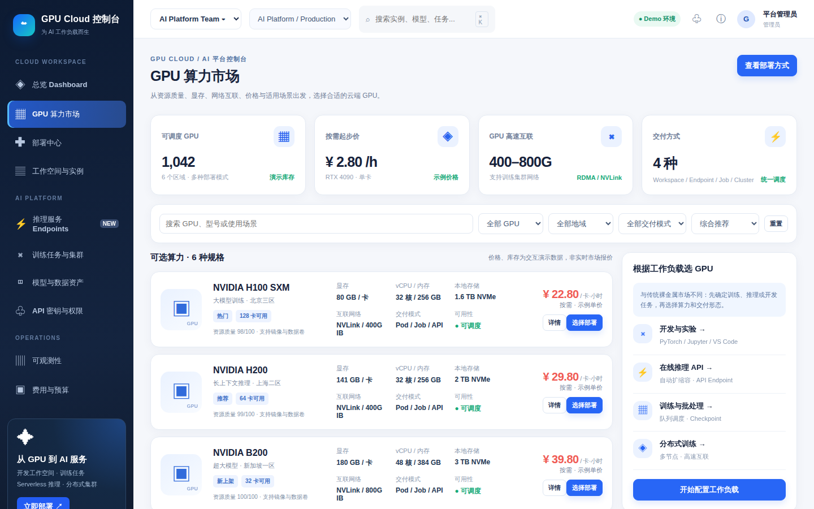
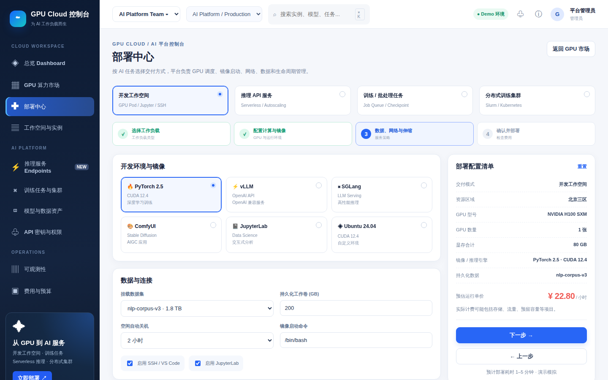
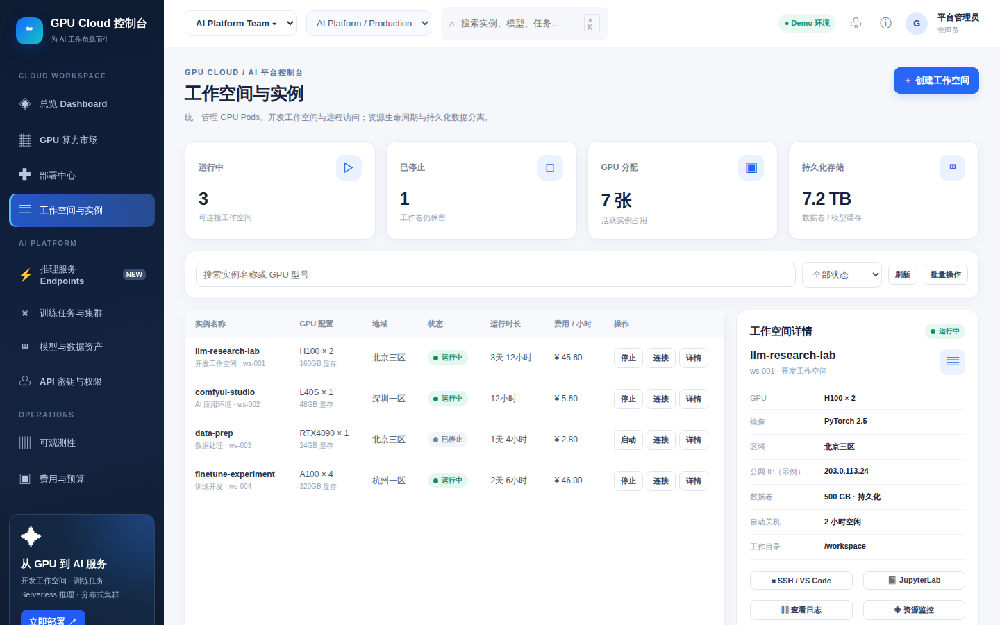
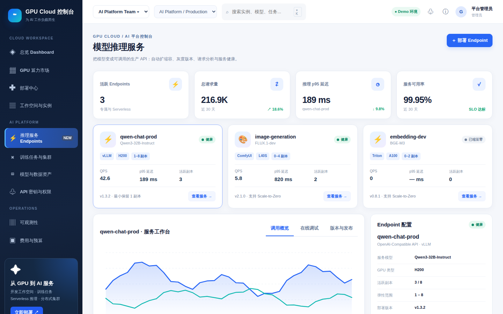
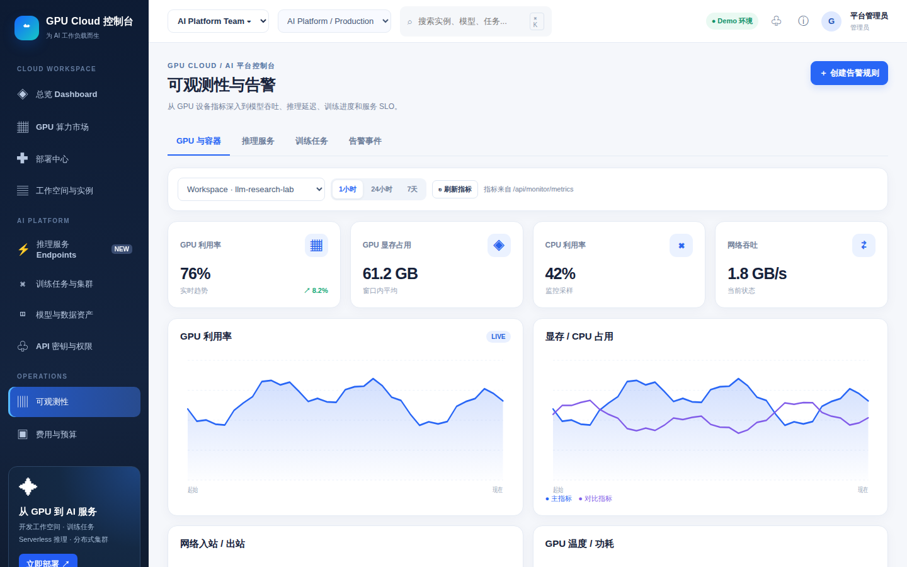
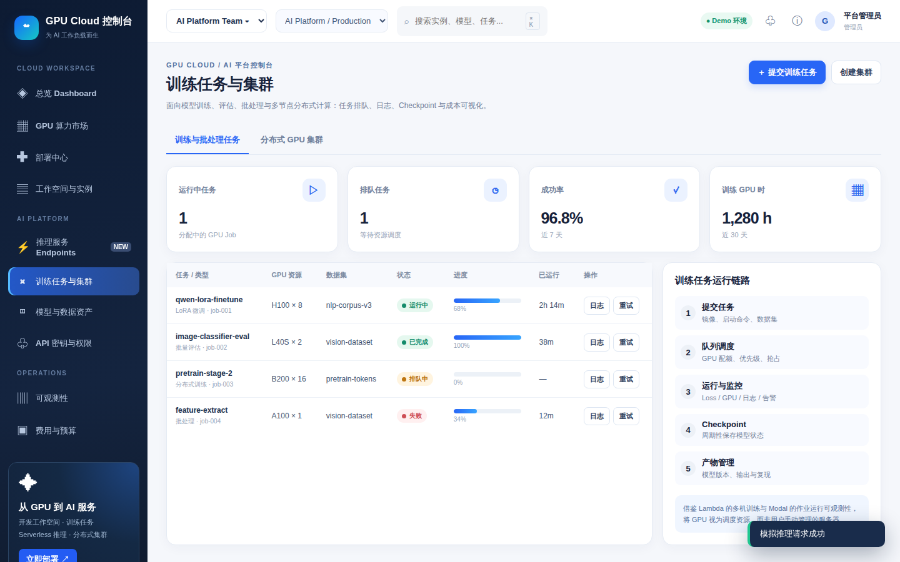
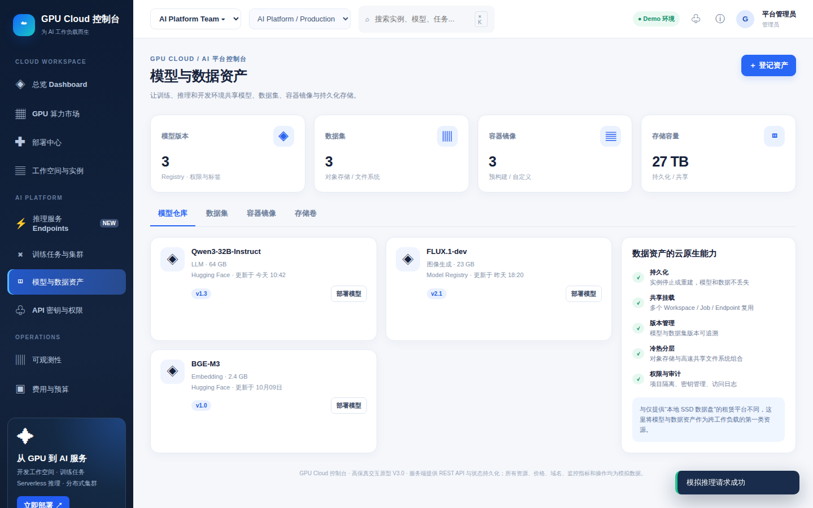
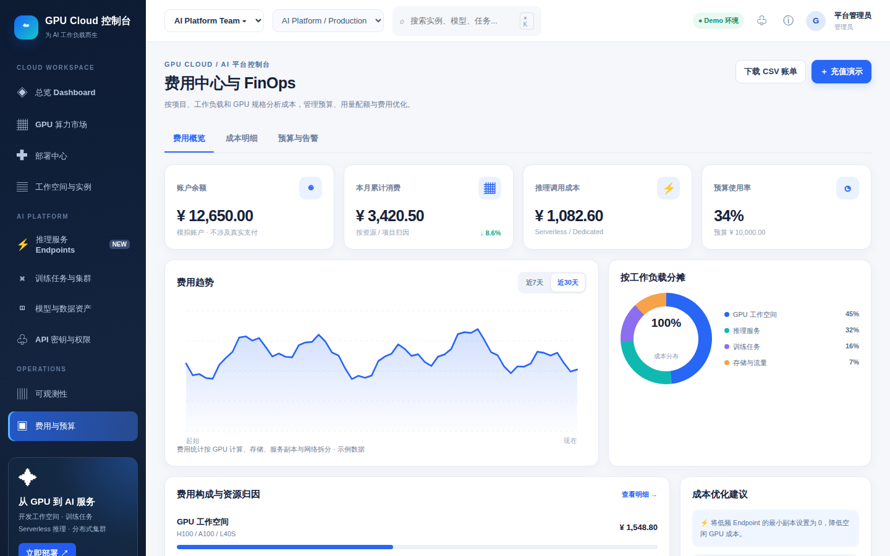

# GPU Cloud 控制台

一体化 GPU 云控制台：从 GPU 选购、部署交付（工作空间 / 训练任务 / 推理 Endpoint / 集群）到实例运维、可观测性与 FinOps 成本分析。

前端为**无构建 ES Module** 架构，后端为 Express REST API + JSON 状态持久化，前后端真实联调。

---

## 在线演示

以下 GIF 均由 **Playwright + Chromium 在真实运行的服务上录制**（1180×720，8fps 采样后合成，2 倍速播放），非设计稿、非静态图。

**演示 1 · 从选购到部署**：总览指标 → 算力市场筛选 H100 并按价格排序 → 查看 GPU 详情 → 进入部署中心走完 4 步向导 → 创建工作空间并跳转到实例列表。


**演示 2 · 实例运维与推理调试**：工作空间启停 → Endpoint Playground 发送测试请求并拿到模拟响应 → 可观测性切换监控目标与告警 → 费用中心查看成本明细。


---

## 界面一览

| 总览 Dashboard | GPU 算力市场 | 部署中心（4 步向导） |
|:---:|:---:|:---:|
|  |  |  |

| 工作空间与实例 | 推理服务 Endpoints | 可观测性 |
|:---:|:---:|:---:|
|  |  |  |

| 训练任务与集群 | 模型与数据资产 | 费用与预算 |
|:---:|:---:|:---:|
|  |  |  |

---

## 设计参考

参考 RunPod（GPU 选购卡片与部署流程）、AutoDL（国内用户习惯与实例控制台）、Vast.ai（复杂资源筛选与价格比较）、优云智算（镜像商城与 AI 应用一键部署）、Modal（开发者体验、监控与日志），重新组织为「开发 / 训练 / 推理 / 数据 / 运营」一体化控制台。

---

## 架构对齐关系（原型 → 本工程）

以单文件原型为唯一标准：目录结构、模块划分、命名规范与代码风格严格对齐，原型缺失的部分按其架构思路补齐。

| 原型（单文件） | 本工程 |
|---|---|
| `GPU / IMAGES / MODELS / NAV` 常量 | `server/data/catalog.js` + `GET /api/catalog` |
| `init` 状态 + `localStorage` | `server/data/seed.js` + `server/store.js`（JSON 持久化）+ 前端 `store.js`（UI 态） |
| `S` / `set(path,value)` / `save()` | 前端 `public/js/store.js`；领域写入走 `PATCH /api/state` |
| `render()` / `shell()` / `nav()` | `public/js/app.js` / `shell.js` |
| `pages{overview,market,create,instances,endpoints,jobs,assets,security,monitor,billing}` | `public/js/pages/*.js`（10 个同名模块）+ `server/routes/*.js`（9 个同名路由） |
| `deploy()` / `instanceAction()` | `server/services/workload.js`（同名函数，服务端执行） |
| `metric/card/section/field/input/select/btn/segmented/chart/status/toast/modal/copy/esc/money` | `public/js/ui.js`（同名同签名） |
| `series()` 模拟时序 | `services/workload.js#series` + `GET /api/monitor/metrics` |
| `styles` 内联 CSS | `public/styles/main.css`（原样迁移，含 `:root` 变量与响应式断点） |

## 目录结构

```
/opt/gdashboard/repo
├── config.js                  # 独立配置（端口/数据文件/日志/静态目录）
├── server/
│   ├── index.js               # 入口：挂载 API + 托管前端
│   ├── store.js               # 状态仓库（load/save/set/pushEvent/reset）
│   ├── data/{catalog,seed}.js # 目录常量与领域数据种子
│   ├── services/workload.js   # 业务逻辑：deploy / instanceAction / series
│   └── routes/                # overview market workloads endpoints jobs assets security monitor billing
├── public/
│   ├── index.html
│   ├── styles/main.css
│   └── js/
│       ├── api.js             # 前后端联调
│       ├── store.js           # 状态（UI 态持久化 + 领域态来自服务端）
│       ├── ui.js  shell.js  app.js
│       └── pages/             # 10 个页面模块
├── docs/
│   ├── demo/                  # 演示 GIF
│   └── screenshots/           # 页面截图
├── data/state.json            # 服务端状态持久化（工程内，不入库）
└── log/server.log
```

## 运行

```bash
cd /opt/gdashboard/repo
npm install     # 仅安装到本工程 node_modules，不全局安装
npm start       # 端口 8080
```

远程访问（8080 未对公网开放时用 SSH 隧道，本地端口避开占用）：

```bash
ssh -i ~/.ssh/enzo-using.pem -N -L 18080:127.0.0.1:8080 ubuntu@13.158.38.7
# 浏览器访问 http://localhost:18080
```

## API

- `GET /api/catalog`、`GET /api/state`、`PATCH /api/state`、`POST /api/state/reset`
- `GET /api/overview`
- `GET /api/market?query=&gpu=&region=&sort=`、`GET /api/market/:id`
- `GET /api/workloads`、`POST /api/workloads/deploy`、`POST /api/workloads/:id/action`
- `GET /api/endpoints`、`POST /api/endpoints/:id/action`（scale/playground/logs/curl）
- `GET /api/jobs`、`POST /api/jobs/:id/retry`、`POST /api/jobs/:id/logs`
- `GET/POST /api/assets`
- `GET /api/security`、`POST /api/security/keys`、`DELETE /api/security/keys/:id`、`POST /api/security/secrets`
- `GET /api/monitor/metrics?tab=&range=`、`GET /api/monitor/events`、`POST /api/monitor/alerts`
- `GET /api/billing`、`POST /api/billing/budget`、`POST /api/billing/recharge`、`GET /api/billing/export`

## 隔离说明

- 工程目录：`/opt/gdashboard/repo`，与开发机其他项目（`/opt/keel`、`/opt/keel-tools`、`/opt/containerd`）完全独立
- 依赖：`npm install` 仅写入本工程 `node_modules`，未做任何全局安装
- 端口：8080（启动前已确认无其他服务占用）
- 配置：`config.js` 自有配置，不复用其他项目配置
- 数据/日志：写入工程内 `data/`、`log/` 目录，已加入 `.gitignore`

## 演示素材制作

`docs/demo/` 下的 GIF 由 Playwright 录制帧序列 + `pngjs` 降采样 + `gif-encoder` 合成，全部依赖装在隔离目录 `/opt/gdashboard/smoke`（不在本工程内）：

```bash
node demo-record.mjs tour   # 录制「选购 → 部署」帧序列
node demo-record.mjs run    # 录制「运维 → 调试」帧序列
node gif.mjs tour out/demo-tour.gif 860 150 2   # 合成 GIF（宽 860 / 150ms / 抽 2 帧）
```
